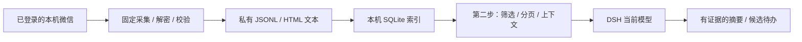

# 架构与数据边界

第一步只接受空对象。选择账号和来源是本机配置行为，路径不进入模型工具参数。采集器读取微信进程与数据库；使用数据库页 HMAC、WAL/SHM 边界、SQLite 完整性和文件哈希校验副本。不写入微信数据库，不注入进程，不发送消息，不保存数据库密钥。

快照是每个数据库尽量保持字节稳定的副本，不是跨数据库事务，也不能证明手机上的历史全部同步。原始字段、二进制可逆表示和可读文本保留在本机；未解码媒体会明确标记。`latest.json` 只指向成功完成的输出。

第二步只读取可读文本的本地索引。时间、类型、指定会话与排除名单取交集，数组内部取并集，排除优先；长期忽略不会影响第一步输出。上下文及旧证据版本也遵守相同约束。任何消息内的指令都是数据。

索引绑定一个账号。会话和消息证据编号由本地随机密钥产生的稳定 HMAC 标识，模型不需要源账号或源路径。分页游标绑定索引版本、筛选和偏好版本；更新后旧游标报错，要求从第一页重新读取。

## 代码位置

| 位置 | 职责 |
| --- | --- |
| `index.js` | 聚合入口：一个组件注册全部 11 个工具，兼容既有安装与既有测试 |
| `components/core.js` | 共享服务组件：唯一 `Config`、唯一 `makeBridge`/`makeWorkflow`、唯一 `initializeConsent`、`ctx.provide('wechatAssistant', api)`、runtime receipt；不注册工具 |
| `components/stage-one.js` | `wechat_prepare`、`wechat_refresh` |
| `components/read.js` | `wechat_status`、`wechat_search`、`wechat_context`、`wechat_review`、`wechat_conversations` |
| `components/tasks.js` | `wechat_save_tasks`、`wechat_list_tasks` |
| `components/preferences.js` | `wechat_get_preferences`、`wechat_set_preferences` |
| `lib/tool-groups.js` | 由 `TOOL_SPECS` 的 action 派生各组件工具归属，并校验 11 个工具不重不漏 |
| `lib/tools.js` | 参数验证、审批接缝、公开结果白名单（未拆分，仍是唯一实现） |
| `lib/consent.js` | 官方 Auto 预设识别、普通模式轮次授权、独立写入确认 |
| `lib/workflow.js` | 显式固定采集串行执行、纯文本查询 |
| `lib/bridge.js` | 无 shell 的 Python 子进程、超时与输出限制 |
| `python/backend.py` | 账号绑定、导入事务、覆盖状态、分页、证据与偏好 |
| `python/collector.py` | 采集适配、进程作业生命周期、限定输出 |
| `collector/` | 本机发现、加密页校验、WAL、副本、JSONL 和离线阅读器 |
| `python/diagnostics.py` | 不创建索引、不扫描进程的环境报告 |
| `tools/release.py` | 明确清单、隐私检查、确定性 ZIP 和校验和 |

## 组件拆分

一个包可以同时导出多个 Cordis 组件。`package.json` 的 `exports` 把五个子路径分别指向一个组件文件：

| 子路径 | 组件 | `name` | `inject` | 工具数 |
| --- | --- | --- | --- | --- |
| `dsh-better-wechat/core` | `components/core.js` | `dsh-better-wechat-core` | `tools` | 0 |
| `dsh-better-wechat/stage-one` | `components/stage-one.js` | `dsh-better-wechat-stage-one` | `tools`、`wechatAssistant` | 2 |
| `dsh-better-wechat/read` | `components/read.js` | `dsh-better-wechat-read` | `tools`、`wechatAssistant` | 5 |
| `dsh-better-wechat/tasks` | `components/tasks.js` | `dsh-better-wechat-tasks` | `tools`、`wechatAssistant` | 2 |
| `dsh-better-wechat/preferences` | `components/preferences.js` | `dsh-better-wechat-preferences` | `tools`、`wechatAssistant` | 2 |
| `dsh-better-wechat`（`"."`） | `index.js` | `dsh-better-wechat` | `tools` | 11（聚合） |

只有 core 声明 `Config`（`confirmReads` / `stateDirectory` / `pythonExecutable`）。功能组件不声明可配置项，因此启停其中一个不会改变其他组件读到的配置。

`core` 在 `apply` 里 `ctx.provide('wechatAssistant', api)`，把唯一 bridge、唯一 workflow、唯一 consent 上下文和注册助手交给功能组件。功能组件只在自己的 ctx 上注册本组工具：Cordis 卸载该组件时释放它注册的工具，其他组件的工具不受影响。所有组件都用 `registerTools(ctx, config, defineTool, specs, bridge, consentCtx)`，其中注册用的 `ctx` 是功能组件自己的上下文，审批用的 `consentCtx` 固定是 core 的上下文。

这条接缝是审批语义的关键：普通模式下同一轮（同 agent / session / turn，同一批用户输入）跨组件的读取仍然只确认一次，因为授权记录只存在于 core 的 consent manager 里，并按 agent 缓存；保存候选待办和修改长期不关注名单仍然各自单独确认。

`python/bridge.py` 的 `runtime_receipt` 接受 `RUNTIME_TOOLS` 的非空、无重复子集，记录当前 host 进程迄今注册过的工具并集（同一 `host_pid` 才合并，换进程不继承），文件键恒为 `{version, tools, loaded_at, host_pid}`，并集保持 `RUNTIME_TOOLS` 顺序。这样能如实反映「只启用了部分组件」的运行状态，同时不泄露账号、路径或消息内容。

不要同时启用聚合入口和 core + 功能组件：两者都会注册同样的 11 个工具名。

### 安装与生效

`dsh.profile.bundles` 里的包在安装/重装时才会应用包内 `cordis.patch.yml`。修改包内 patch 不会改变已经安装的 profile：

1. `cordis.patch.yml` 插入 5 个条目（`dsh-better-wechat-core`、`-stage-one`、`-read`、`-tasks`、`-preferences`），只有 core 带 `config: {confirmReads: true}`。
2. 安装/重装这个 bundle 时，profile 的 `cordis.yml` 会由这 5 个条目**整体替换**旧的聚合条目。因此**不要在 profile 级 `cordis.patch.yml` 里再 insert 一遍同样的 5 个 id**：bundle 层已经提供这些行，重复插入属于冗余且容易引发混乱。只有在 profile 仍残留旧聚合条目（例如升级前的 `- id: dsh-wechat-assistant`）时才需要把它标为 `disabled: true`。
3. 新插入的行只在**宿主重启后**才会激活。实测：仅重装 bundle 而不重启时，这 5 行处于「已声明、未启动」（插件管理里 `enabled: true`、`fiberPhase: null`），对应的 `wechat_*` 工具在宿主里不存在；重启后 5 个组件全部激活，11 个工具按组注册。子路径组件的解析依赖 profile 已重新链接本包（`node_modules/dsh-better-wechat`）。
4. 本地私有数据目录名与包名解耦：默认优先 `dsh-better-wechat`，若它不存在而旧的 `dsh-wechat-assistant` 已有数据，则继续沿用旧目录，重命名不会要求重建索引。

## 覆盖状态

`readable_text_ready` 表示有本地可读材料。`stage_one_coverage` 为 `full` / `partial` / `unknown`；这里的 full 仅代表采集源范围未被筛选，不代表所有设备的微信历史。旧版局部来源不能因为导入成功而变成完整覆盖。

`latest_snapshot_at` 是全范围快照时间；`latest_import_at` 是入库时间。`refresh_required` 和具体范围的 `scope_refresh_required` 告诉调用方材料是否足够新。第二步不会自动刷新；需要新材料时显式调用第一步。返回空页不等于当天没有消息。
